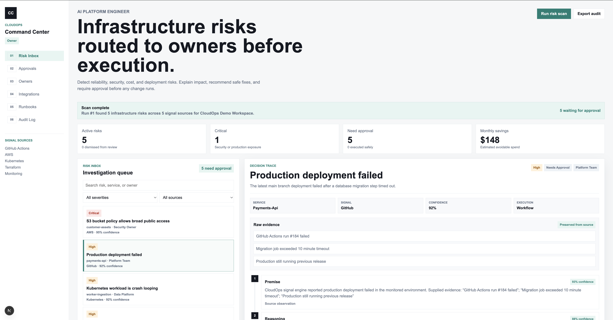
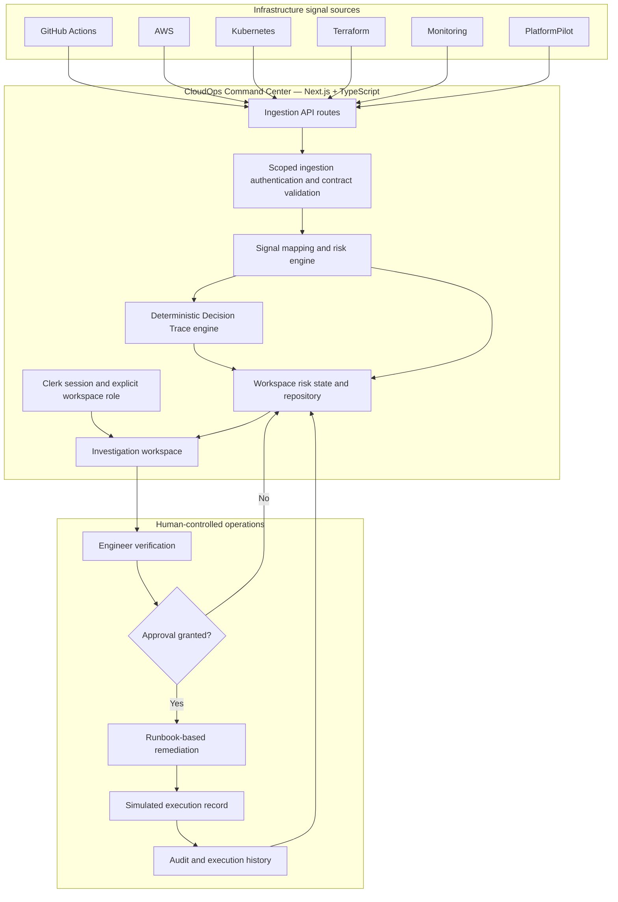
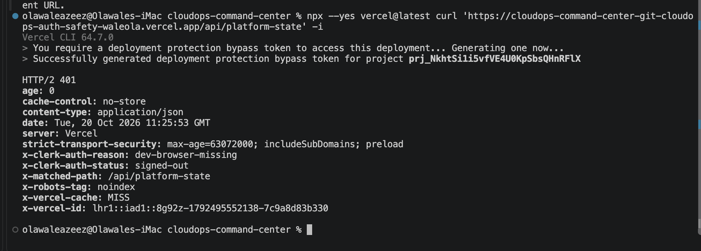
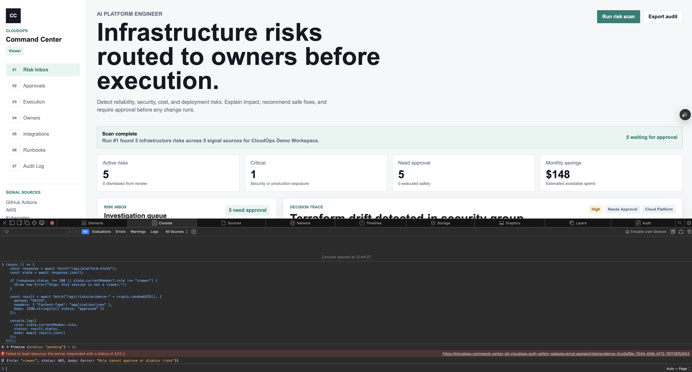

# CloudOps Command Center

[](https://github.com/AZ1600/cloudops-command-center/actions/workflows/ci.yml)

CloudOps Command Center is a platform engineering assistant that turns infrastructure signals into explainable, owner-routed, approval-gated remediation workflows.

It brings risk detection, raw evidence, service ownership, deterministic Decision Traces, runbooks, human approvals, controlled execution, and audit history into one operational workspace.

[Hosted demo](https://cloudops-command-center.vercel.app/) · [Authentication and access setup](docs/authentication.md) · [Finding contract](contracts/operational-finding.schema.json)

## Current Status

This is a deployed portfolio application with authenticated workspace access, evidence-based investigation, and simulated remediation. The hosted deployment currently uses a Clerk development instance. Signing up alone does not grant access: a trusted administrator must assign a workspace and role, and the user's primary email must be verified.

The authentication update was verified on a Vercel preview with an owner account, a signed-out API request, and a viewer approval rejection. Workspace isolation and persistence hardening remain follow-up work before supporting separate customer workspaces.


The owner dashboard shows seeded demonstration risks, service ownership, raw evidence, and the human approval boundary. Displayed savings and confidence values are demonstration estimates, not measured customer outcomes.

## Project Overview

The overview below summarizes the investigation experience, system architecture, five-step Decision Trace, safety boundary, and core technology stack.


## Problem It Solves

Cloud and platform teams receive signals from GitHub Actions, AWS, Kubernetes, Terraform, and monitoring systems. Seeing an alert is only the beginning. Engineers still need to determine:

- What is risky and why does it matter?
- Which service and environment are affected?
- What evidence supports the recommendation?
- Who owns the service?
- What must be verified before remediation?
- Is human approval required?
- Can the decision and resulting action be audited later?

CloudOps Command Center connects those questions into one controlled workflow.

## Core Workflow

```text
Infrastructure signal
        ↓
Validation and risk mapping
        ↓
Raw evidence + service ownership
        ↓
Deterministic Decision Trace
        ↓
Engineer verification
        ↓
Human approval boundary
        ↓
Simulated remediation
        ↓
Audit and execution history
```

## Decision Trace

Each supported risk can include an auditable Decision Trace with five typed steps:

```text
Premise → Reasoning → Hypothesis → Verification → Conclusion
```

Every step has a stable ID, explicit dependencies, and a confidence value bounded between `0` and `1`. The premise cites supplied evidence, the hypothesis remains conditional, the verification step names what an engineer must check, and the conclusion preserves the approval boundary.

The trace is a deterministic application artifact built from structured evidence and fixed templates. It does not require MCP or an LLM and cannot authorize or execute infrastructure changes.

PlatformPilot risks continue to enforce:

```text
approvalRequired: true
status: needs_approval
executionMode: manual
```

## Investigation Workspace



The investigation workspace separates overview work from detailed analysis:

- The left-hand queue supports search plus severity and source filters.
- Selecting a risk opens its service, owner, source, confidence, and execution metadata.
- Raw evidence is preserved separately from interpretation.
- The trace shows how each reviewable step depends on earlier evidence.
- Approval controls remain outside the trace itself.

### Complete Decision Trace


This view shows the complete five-step trace. Confidence decreases as the trace moves from source observations toward a hypothesis and conclusion, reflecting increasing uncertainty. The final panel makes the operational boundary explicit: no infrastructure change runs from the trace, and a human must review the evidence before remediation.

## Architecture



### Architectural responsibilities

| Layer | Responsibility |
| --- | --- |
| Signal sources | Supply workflow, cloud, cluster, plan, and monitoring observations. |
| Ingestion APIs | Accept supported inputs without granting execution authority. |
| Browser authentication | Requires a Clerk session, verified primary email, and explicit workspace/role assignment before data access. |
| Validation and authentication | Rejects malformed or unauthorized PlatformPilot findings before storage, using a separate integration token and workspace assignment. |
| Risk engine | Normalizes signals into categorized, owner-routed infrastructure risks. |
| Decision Trace engine | Produces deterministic, evidence-backed steps with bounded confidence and dependencies. |
| Repository | Uses Postgres when `DATABASE_URL` is set, otherwise a process-local in-memory demo store; workspace isolation needs further hardening. |
| Investigation workspace | Presents the queue, raw evidence, trace, recommendation, and approval boundary. |
| Human-controlled operations | Requires approval before recording simulated remediation; runbooks describe verification and rollback steps for human review. |
| Audit history | Records scans, approvals, dismissals, and simulated execution events. |

## Features

- Searchable risk inbox with severity, source, status, service, owner, and confidence context
- Deterministic Decision Traces over PlatformPilot findings and demo risks
- Raw evidence preserved separately from hypotheses and conclusions
- Owner routing and service catalog
- Approval queue and permission-aware controls
- Clerk sign-in with explicit workspace roles and verified primary email checks
- API authentication and permission checks before repository access
- Runbooks with safety checks and rollback plans
- GitHub Actions workflow-failure import
- Terraform plan JSON risk detection
- PlatformPilot contract validation and authenticated ingestion
- Structured JSON operational telemetry with request correlation IDs
- Simulated execution evidence and audit history
- Responsive investigation workspace

## Operational Telemetry

API operations emit structured JSON events for key ingestion and remediation decisions.

Each event includes:

- a request correlation ID
- route and event name
- outcome and HTTP status
- risk or finding context when available
- requested and current status where relevant
- actor role and rejection or blocking reason

Supported upstream `x-request-id` values are preserved and returned in API responses. When one is not supplied, CloudOps Command Center generates a request ID for correlation.

This runtime telemetry complements the persisted audit and execution history rather than replacing it.

## Technology Stack

- Next.js and React
- TypeScript
- Vitest
- GitHub Actions
- AJV and JSON Schema
- Clerk authentication required for production browser access
- Neon/Postgres-ready persistence
- Vercel-ready deployment

## Validation

```bash
npm run test
npm run lint
npm run typecheck
npm run build
npm run contracts:validate
git diff --check
```

Verified on the authentication branch on 20 October 2026:

| Check | Result |
| --- | --- |
| Automated suite | 120 tests passed across 17 files |
| Authentication regression subset | 77 tests passed across 3 files, included in the 120 total |
| TypeScript and production build | Passed |
| Operational-finding contract validation | Passed locally |
| Whitespace check | Passed |
| GitHub Actions `validate` job | Passed |
| Preview owner access | Authenticated owner dashboard loaded |
| Preview signed-out API access | HTTP 401 with `Cache-Control: no-store` |
| Preview viewer approval attempt | HTTP 403: `Role cannot approve or dismiss risks` |

`npm run lint` passes, but the current ESLint configuration does not cover TypeScript files. Changed authentication sources were additionally checked against Next.js lint rules in an isolated validation copy. Expanding the repository's lint configuration remains a follow-up.

The automated authentication tests mock Clerk responses. The preview checks above exercise the deployed Clerk integration; they do not establish complete workspace isolation or production readiness.

### Authentication evidence

The screenshots use demonstration workspace data.

- [Authentication regression tests](docs/screenshots/auth-regression-tests.png): the targeted test suite and passing counts.
- [Authenticated owner dashboard](docs/screenshots/authenticated-owner-dashboard.png): owner access after verified sign-in and workspace assignment.

<details>
<summary>Signed-out API request: 401 with no-store</summary>



The request uses `vercel curl` to pass Vercel deployment protection without supplying a Clerk session. This tests application authentication separately from access to the preview deployment.

</details>

<details>
<summary>Viewer approval request: 403</summary>



The console first confirms a viewer session, then sends an approval request for a newly generated, nonexistent risk ID. The server rejects the request before modifying a risk. The red 403 console entry is expected for this check.

</details>

## Authentication boundary

Production browser access requires Clerk, a verified primary email, and explicit
workspace and role assignments in backend-managed public metadata. Authentication
failures cannot fall back to a demo owner. Local development retains demo access
only when neither Clerk key is configured.

| Operation | Minimum role |
| --- | --- |
| Read the workspace | viewer |
| Import GitHub runs or Terraform plans | engineer |
| Approve, dismiss, or simulate execution | admin |
| Reset the demo risk scan | owner |

Missing sessions return 401, invalid assignments or insufficient permissions return 403, and missing or unavailable authentication configuration returns 503. Authentication error responses use `Cache-Control: no-store`.

PlatformPilot ingestion uses its own token and an explicit target workspace,
independently from browser sessions.

See [Authentication setup and screenshot evidence](docs/authentication.md) for
deployment prerequisites, role permissions, verification commands and the
screenshots to capture. Workspace isolation and persistence hardening remain a
separate follow-up; this authentication change is not a production certification.

## Local Development

Use Node.js 22, matching the GitHub Actions configuration.

```bash
git clone https://github.com/AZ1600/cloudops-command-center.git
cd cloudops-command-center
npm ci
npm run dev
```

Open [http://localhost:3000](http://localhost:3000). With neither Clerk key configured, development uses the demo-owner identity. With no `DATABASE_URL`, data is held in memory and can reset when the process restarts. A partial Clerk configuration does not enable demo access.

### Deployment configuration

Configure values through your deployment provider or an ignored local environment file. Keep credentials out of Git.

| Variable | Purpose |
| --- | --- |
| `NEXT_PUBLIC_CLERK_PUBLISHABLE_KEY` | Public Clerk key, included in the browser build; must match the secret key's instance. |
| `CLERK_SECRET_KEY` | Server-only Clerk credential. |
| `DATABASE_URL` | Postgres connection string; required for persistent data. |
| `DATABASE_SSL` | Set to `false` only when connecting to an appropriate local database without TLS. |
| `GITHUB_TOKEN` | Optional server-side GitHub API credential for authenticated workflow imports. |
| `PLATFORM_PILOT_INGEST_TOKEN` | Server-side shared credential for PlatformPilot ingestion. |
| `PLATFORM_PILOT_WORKSPACE_ID` | Existing workspace assigned to the integration; required outside the unconfigured local demo. |

The embedded sign-in route is `/login`, with catch-all handling for verification and callback steps. Use the same Clerk instance for both keys. Configure authorized users through backend-managed public metadata, for example `workspaceId: "workspace-demo"` and `role: "owner"` for the demo workspace's owner. New workspaces are not provisioned automatically.

Apply the database schema after configuring `DATABASE_URL`:

```bash
npm run db:apply
```

Vercel environment changes apply to new deployments. Redeploy the intended Preview or Production environment after changing keys. Protected preview links may additionally require Vercel access or a generated shareable link; this is separate from Clerk authentication inside CloudOps.

See [.env.example](.env.example) and [the authentication guide](docs/authentication.md) for setup and role-verification instructions.

## Implemented Capabilities and Demo Boundaries

| Area | Current behavior |
| --- | --- |
| GitHub Actions | Imports recent workflow runs through the GitHub API and maps failures into reviewable risks. |
| Terraform | Parses supplied plan JSON; does not run Terraform against a cloud account. |
| PlatformPilot | Accepts contract-validated findings through a separately authenticated endpoint. |
| AWS, Kubernetes, and monitoring examples | Seeded demonstration signals; connector labels do not establish live collection. |
| Decision Traces | Deterministic evidence-based templates, without an LLM dependency. |
| Execution | Records simulated remediation and evidence; does not apply cloud changes, dispatch workflows, or open remediation PRs. |
| Workspace access | Explicit authenticated workspace assignments and roles; full storage isolation is not yet established. |

## Next Improvements

- Isolate in-memory and Postgres storage consistently between workspaces, including identifiers and workspace provisioning.
- Require persistent storage for deployed environments and strengthen database transport configuration.
- Expand ESLint coverage to TypeScript and TSX sources.
- Move the hosted demo from Clerk development keys to a configured production instance for a production launch.
- Add real execution integrations with approval enforcement, retry handling, and auditable results.

## Additional Screenshots

### Approval and execution flow


Shows how an approved risk enters the execution gate and becomes part of the audit trail.

### Owner routing


Summarizes urgent, waiting, approved, and completed work for each service owner.

### Service catalog


Connects services with owners, environments, runtimes, integrations, health, and active risks.

### Integration status


Shows which infrastructure signal sources are connected, mocked, or awaiting configuration.

### Runbooks


Documents controlled remediation procedures, safety checks, and rollback plans.

## Skills Demonstrated

- Platform engineering: service ownership, runbooks, approvals, operational safety, and auditability
- Cloud engineering: AWS, Kubernetes, Terraform, deployment, reliability, security, and cost risk modeling
- DevOps: GitHub Actions, contract validation, testing, production builds, and deployment readiness
- Product engineering: workflow-driven UX, explainable decision artifacts, responsive design, and portfolio documentation

## Author

Olawale Azeez  
AWS Certified Developer Associate
AWS Certified Solutions Architect -Associate  
AWS Certified Cloud Practitioner  
Cloud Engineer | Platform Engineer | DevOps Engineer
